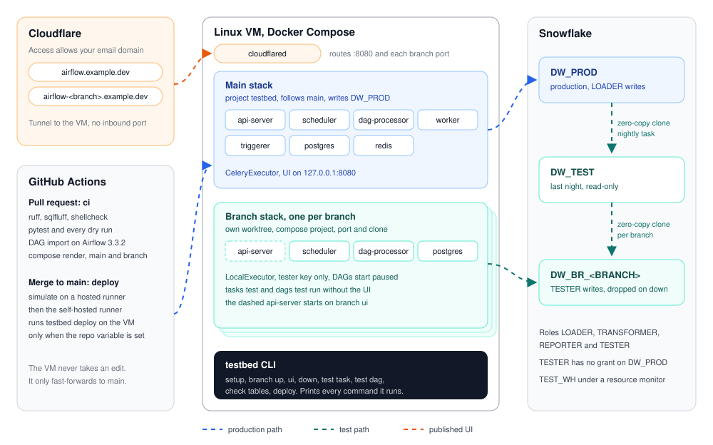

# Airflow Snowflake testbed

[](https://github.com/loctu0402/airflow-snowflake-testbed/actions/workflows/ci.yml)


Test an Airflow change against production-shaped data without touching production. Every git branch gets its own
Airflow stack on the VM and its own zero-copy clone in Snowflake, and one task or a whole DAG runs from the command
line, no UI needed.



## The problem

A pipeline change is proven only on data that looks like production: the real volumes, late rows and duplicates.
That data lives only in production, and a test run there can overwrite tables that reports read. A shared test
database helps until two branches write to it on the same day.

- **Nightly baseline.** A Snowflake task clones `DW_PROD` into `DW_TEST` at 04:00 UTC. The clone takes seconds and
  adds storage only for rows that change afterwards.
- **One clone per branch.** `testbed branch up` clones `DW_TEST` into `DW_BR_<BRANCH>` through an owner's-rights
  procedure that accepts only `DW_BR_` names. The branch stack signs in as `TESTER`, which has no grant on `DW_PROD`.
- **One stack per branch.** The branch runs from its own git worktree, under its own Compose project, port and
  metadata database. Sources are read for real; writes land only in the clone.
- **Production only fast-forwards.** The VM checkout follows `main`. A merge is the deploy, and nobody edits files
  on the VM.

| Path | Holds |
|---|---|
| `snowflake/` | Warehouses, roles, users, grants, the resource monitor, tables, the nightly clone and the branch clone procedures, in run order |
| `airflow/` | Docker Compose for Airflow 3.3.2, the env template, three DAGs and the SQL they run |
| `cloudflare/` | Tunnel config template, Access application and Access policy |
| `toolkit/testbed/` | The `testbed` CLI, standard library only |
| `.github/workflows/` | `ci` on every pull request, `deploy` on every merge to `main` |

## Quick start

**Snowflake.** Run `snowflake/01_warehouses.sql` to `08_branch_clones.sql` in order as a user holding
`ACCOUNTADMIN`; each file switches to the role it needs. Then give the two service users their keys:

```bash
openssl genrsa 2048 | openssl pkcs8 -topk8 -nocrypt -out loader.p8
openssl genrsa 2048 | openssl pkcs8 -topk8 -nocrypt -out tester.p8
openssl rsa -in loader.p8 -pubout
```

```sql
ALTER USER SVC_AIRFLOW SET RSA_PUBLIC_KEY = '<loader public key>';
ALTER USER SVC_AIRFLOW_TEST SET RSA_PUBLIC_KEY = '<tester public key>';
```

**VM**, Ubuntu 24.04:

```bash
sudo mkdir -p /opt/testbed && sudo chown "$USER" /opt/testbed
git clone https://github.com/loctu0402/airflow-snowflake-testbed.git /opt/testbed/repo
sudo ln -s /opt/testbed/repo/bin/testbed /usr/local/bin/testbed
testbed setup
mv loader.p8 tester.p8 /opt/testbed/secrets/ && chmod 600 /opt/testbed/secrets/*.p8
cd /opt/testbed/repo/airflow && cp .env.example .env
```

Fill `.env`: `AIRFLOW_UID` from `id -u`, the passwords and secrets from `openssl rand -hex 32`, the Fernet key from
`python3 -c "import base64, os; print(base64.urlsafe_b64encode(os.urandom(32)).decode())"`, the Snowflake account
and the source API tokens. Then `docker compose up -d`.

**Cloudflare.** Create the tunnel, then run `setup` again: it writes `/etc/cloudflared/config.yml`, routes
`airflow.example.dev` and installs the service.

```bash
cloudflared tunnel login
cloudflared tunnel create testbed
sudo mkdir -p /etc/cloudflared && sudo cp ~/.cloudflared/<tunnel-id>.json /etc/cloudflared/
export TESTBED_TUNNEL_ID=<tunnel-id>
testbed setup
```

Put Cloudflare Access in front of every hostname on the zone:

```bash
api=https://api.cloudflare.com/client/v4/accounts/$CF_ACCOUNT_ID/access
policy=$(curl -s "$api/policies" -H "Authorization: Bearer $CF_API_TOKEN" --json @cloudflare/access-policy.json | jq -r .result.id)
jq --arg id "$policy" '.policies = [{"id": $id, "precedence": 1}]' cloudflare/access-app.json \
  | curl -s "$api/apps" -H "Authorization: Bearer $CF_API_TOKEN" --json @-
```

## The branch workflow

1. Push the branch, then `testbed branch up feature/pos-refunds`. It adds the worktree, writes `.env.branch`, clones
   `DW_TEST` into `DW_BR_FEATURE_POS_REFUNDS` and starts the scheduler and dag-processor. Add `--tunnel` to publish
   `https://airflow-feature-pos-refunds.example.dev`.
2. Run what changed: `testbed test task pos_orders fetch_orders --branch feature/pos-refunds --date 2026-11-06`, or
   the whole DAG with `testbed test dag pos_orders --branch feature/pos-refunds`.
3. Check what it wrote: `testbed check tables POS.ORDERS --branch feature/pos-refunds` prints row count, last write
   and minutes since that write, for the branch clone and `DW_TEST` side by side.
4. Click through when a run needs eyes: `testbed branch ui feature/pos-refunds`.
5. Merge, then `testbed branch down feature/pos-refunds`. The merge deploys; `down` drops the clone, the stack, its
   volumes and the worktree.

## Commands

Every command prints the exact shell it runs. `--dry-run` prints the same lines and runs nothing.

| Command | What it runs |
|---|---|
| `testbed setup` | Checks git, Docker, Compose, cloudflared and the folders under `/opt/testbed`, and installs what is missing. With `TESTBED_TUNNEL_ID` set, it also writes the tunnel config, routes the main hostname and installs the service |
| `testbed branch up <branch> [--tunnel]` | `git worktree add`, `.env.branch`, `CALL OPS.TESTBED.CREATE_BRANCH_CLONE`, then `docker compose -p testbed-<branch> up -d`. Run it again to pull new commits and reset the clone |
| `testbed branch ui <branch>` | Starts the branch api-server on its own port, bound to `127.0.0.1`, and prints the SSH forward and the hostname |
| `testbed test task <dag> <task> --branch <branch>` | `airflow tasks test` in the branch scheduler, for `--date` or yesterday in UTC |
| `testbed test dag <dag> --branch <branch>` | `airflow dags test`, every task of one run in one process |
| `testbed check tables <SCHEMA.TABLE>... --branch <branch>` | Reads `INFORMATION_SCHEMA.TABLES` in the branch clone and in `DW_TEST` |
| `testbed branch down <branch>` | `CALL OPS.TESTBED.DROP_BRANCH_CLONE`, `docker compose down --volumes`, removes the tunnel rule and the worktree |
| `testbed deploy` | Refuses unless the VM checkout is on `main` with no local change, then `git merge --ff-only`, `airflow dags reserialize` and `airflow dags list-import-errors`, which fails on any import error |

`TESTBED_HOME` (default `/opt/testbed`) and `TESTBED_DOMAIN` (default `example.dev`) move the toolkit elsewhere. A
branch port is 8100 plus a hash of the branch name, below 8900.

## What CI proves

- **Lint.** ruff, SQLFluff with the Snowflake dialect over every SQL file, shellcheck on the launcher.
- **Toolkit**, on Python 3.11 and 3.12. pytest covers branch-name sanitising, every name derived from it, that each
  branch database passes the guard inside the Snowflake procedure, the exact command each step builds, the runner
  stopping at the first failure, and `--dry-run` printing every command while running none. Then every command runs
  once with `--dry-run`.
- **DAGs**, on Python 3.11 and 3.12. Airflow 3.3.2 installs with its constraints file, the DagBag imports every DAG,
  and every SQL file a task names resolves.
- **Compose.** The main stack renders from `.env.example`, and a branch stack renders with its port, executor and
  database taken from `.env.branch`.
- **Deploy.** On every merge a hosted runner starts the previous commit of `main` in Docker Compose, deploys the new
  commit with `testbed deploy` and checks that every DAG is listed. The self-hosted job then runs the same command on
  the VM, only when the repository variable `TESTBED_DEPLOY_ENABLED` is `true`.

Snowflake and Cloudflare need credentials, so CI proves the commands, not their effect in those accounts.
